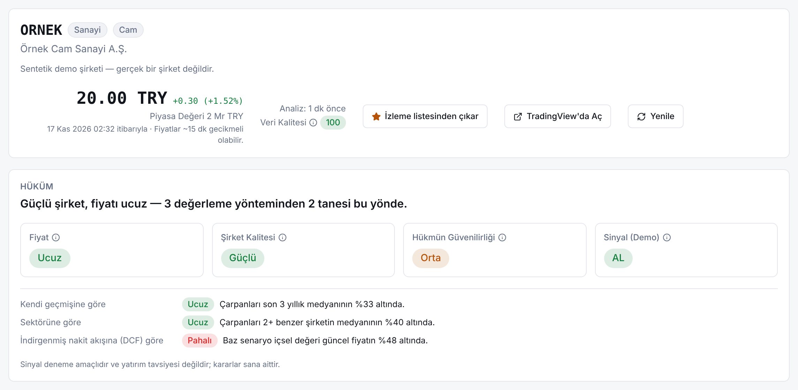
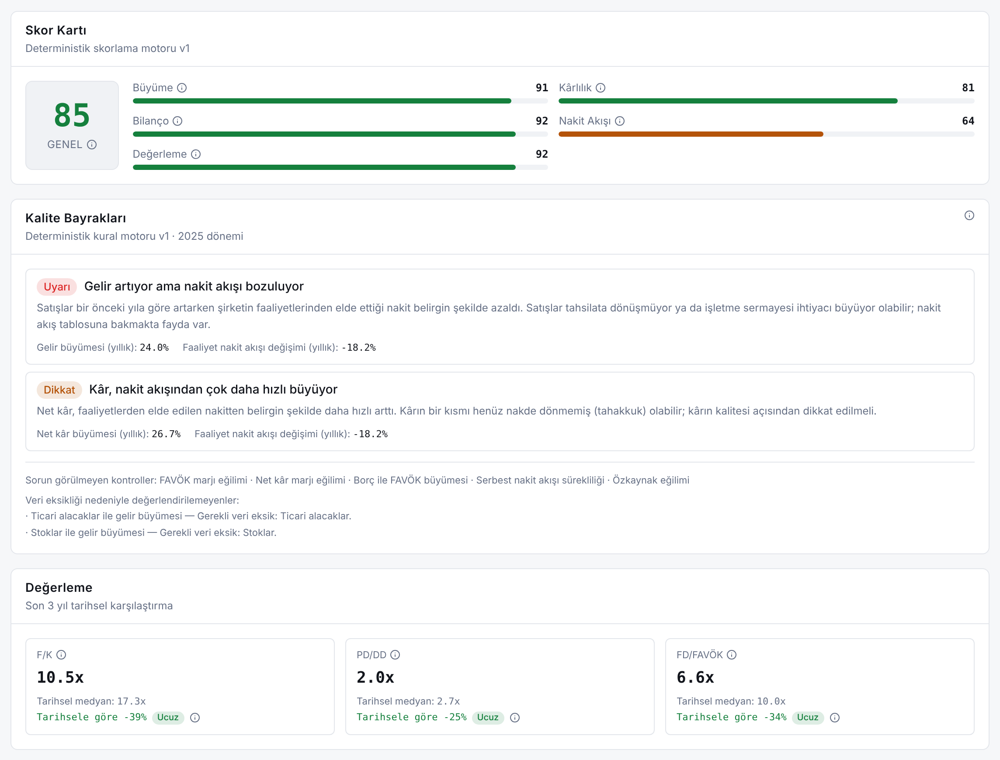
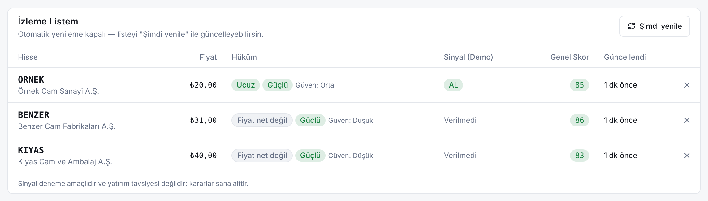
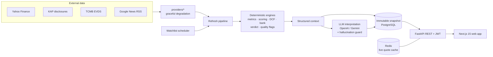

# Investify

[](https://github.com/ozanozenn/investify/actions/workflows/ci.yml)
[](LICENSE)

**Evidence-based investment research platform for Borsa Istanbul (BIST).**

Investify pulls market prices, financial statements, regulatory disclosures
(KAP) and macro data for a BIST company, runs them through deterministic
valuation and scoring engines, and adds an LLM-written explanation on top —
without ever letting the LLM do the math. It is built with FastAPI,
PostgreSQL, Redis and Next.js, and every analysis is stored as an immutable,
reproducible snapshot so you can see exactly what the system said, and why,
on any given day.

> Not a trading bot and not investment advice. A rule-based buy/hold/sell
> label is shown only as a clearly marked demo and can be switched off with
> one config flag ([ADR-011](docs/adr/ADR-011-verdict-card-and-demo-signal.md)).

## Screenshots

> Screenshots use **synthetic demo data** (fictional companies such as
> "Örnek Cam Sanayi A.Ş."), not real market data. The UI is in Turkish.

**Verdict at a glance** — three valuation methods vote on cheap / fair /
expensive; company quality comes from the deterministic score.



**Why** — score breakdown, rule-based quality flags and valuation vs. the
company's own history.



**Watchlist** — refreshed automatically after market close.



## Highlights

- **Deterministic engines, LLM only interprets.** Financial ratios, a
  config-driven scoring model, DCF (bear/base/bull + WACC × terminal-growth
  sensitivity), peer comparison and a bank-specific engine are pure Python
  functions with thresholds in versioned YAML. The LLM receives
  pre-formatted numbers and is only allowed to explain them.
- **Verdict engine.** Own-history multiples, sector medians and DCF each
  vote; a price verdict is given only when a real majority agrees, and
  missing data is never guessed (`missing_fields`, no silent defaults).
- **Hallucination guard.** Every number in the LLM's text is checked
  against what was actually in its prompt; unsupported numbers trigger one
  corrective retry and are shown as a warning in the UI.
- **Inflation-aware analysis.** Rule-based quality flags (e.g. "revenue up,
  operating cash flow down") and real (CPI-adjusted) growth — essential in
  a high-inflation market.
- **Multi-source data layer.** Yahoo Finance, KAP, Central Bank (TCMB EVDS)
  and Google News, with graceful degradation per source, plus an opt-in
  second financial source with cross-source validation.
- **Reproducibility.** Each refresh writes an immutable snapshot with engine
  and prompt versions, so history and "what changed since last time" are
  exact.
- **Watchlist + scheduler.** In-process scheduler refreshes the watchlist
  after market close; a Postgres advisory lock prevents duplicate runs
  across workers.

## Architecture



- **Modular monolith** with a one-way import rule: routers → services →
  {providers, engines, llm} → models
  ([ADR-001](docs/adr/ADR-001-monorepo-and-backend-framework.md)).
- **LLM never computes** ([ADR-003](docs/adr/ADR-003-llm-separation.md)).
- **Snapshots are immutable** ([ADR-005](docs/adr/ADR-005-analysis-snapshots-and-reproducibility.md)).

More detail: [docs/ARCHITECTURE.md](docs/ARCHITECTURE.md) and the
[16 Architecture Decision Records](docs/adr/README.md).

## Tech stack

| Area | Technologies |
|---|---|
| Backend | Python 3.12, FastAPI, Pydantic v2, SQLAlchemy 2.0 (async), Alembic |
| Data | PostgreSQL, Redis, pandas, yfinance |
| LLM | OpenAI and Google Gemini (structured outputs), provider fallback chain |
| Frontend | Next.js 15 (App Router), React 19, TypeScript, Tailwind CSS, TanStack Query |
| Quality | pytest (424 tests), ruff, ESLint, TypeScript strict, GitHub Actions CI |
| Ops | Docker Compose, JWT auth |

## Quick start

```bash
cp .env.example .env      # set APP_USER_EMAIL / APP_USER_PASSWORD / JWT_SECRET
# optional: EVDS_API_KEY, GEMINI_API_KEY or OPENAI_API_KEY — see docs/DATA_SOURCES.md
docker compose up --build
```

- Web app: http://localhost:3000 — log in with the credentials from `.env`.
- API: http://localhost:8000 (OpenAPI docs at `/docs`).
- Without an LLM key, a clearly labelled mock LLM is used so the whole
  pipeline still runs.

Running the API and web app without Docker: [docs/DEPLOYMENT.md](docs/DEPLOYMENT.md).

## Testing and quality

```bash
cd apps/api && pytest tests -q && ruff check .           # 424 tests
cd apps/web && npm run lint && npm run typecheck && npm run build
```

Backend tests cover the engines with hand-checked fixtures, provider
response parsing, the hallucination guard, and full API integration flows
(fake providers, real FastAPI app, real engines) — including partial
provider failure, bank vs. unsupported sectors, auth and the scheduler. CI
runs the same checks on every push and pull request.

## Project status

- **Live-verified against real data:** the core pipeline (prices,
  statements, KAP, FX, scoring) was run against the real services on
  2026-08-17.
- **Verified with tests and synthetic data only:** features added later —
  verdict engine, bank engine, quality flags, watchlist, prompt v4 — because
  the development environment had no access to the data providers.
  Checklist for a live run: [docs/V1_DOGRULAMA.md](docs/V1_DOGRULAMA.md).
- **Built but off by default:** İş Yatırım as a second financial-statement
  source and the full BIST company-list import, until they are verified
  against the live endpoints ([ADR-015](docs/adr/ADR-015-financial-data-sources-v2.md)).
- Roadmap and known gaps: [docs/ROADMAP.md](docs/ROADMAP.md),
  [docs/TECHNICAL_DEBT.md](docs/TECHNICAL_DEBT.md).

## How I built this

Investify is a solo project built with AI coding agents (Anthropic's
Claude Code); most of the code, tests and documentation were written by
the agents, and commits they co-authored carry a `Co-Authored-By: Claude`
trailer.

My part was product and technical ownership:

- **Product and constraints:** what the tool should and should not do
  (evidence-based, trading signals only as a labelled demo, Turkish-first UI) and the
  hard rules the agents had to follow — the LLM never computes, missing data
  is never guessed, snapshots are immutable.
- **Decisions:** choosing between the options the agents laid out — data
  sources, how the verdict should work, which features to build, defer or
  remove — recorded as [ADRs](docs/adr/README.md).
- **Process:** a written agent guide ([AGENTS.md](AGENTS.md)) with tests and
  lint as a gate for every change, separate code-review agent passes on
  larger changes, and the rule that new data integrations stay disabled until they
  are verified against the real API. Larger features were split across
  parallel agents in isolated git worktrees and then integrated and
  reviewed.
- **Review:** checking results in the running app and asking for fixes
  when something was wrong or unclear.

## Documentation

| Doc | Contents |
|---|---|
| [docs/ARCHITECTURE.md](docs/ARCHITECTURE.md) | System shape, refresh pipeline, layering rules |
| [docs/adr/](docs/adr/README.md) | Architecture Decision Records (Turkish) |
| [docs/DATA_SOURCES.md](docs/DATA_SOURCES.md) | External data sources and credentials |
| [docs/FINANCIAL_ENGINE.md](docs/FINANCIAL_ENGINE.md) | Every formula, with edge cases |
| [docs/SCORING.md](docs/SCORING.md) | Scoring model and explainability contract |
| [docs/LLM.md](docs/LLM.md) | Provider chain, prompt versioning, hallucination guard |
| [docs/DATABASE.md](docs/DATABASE.md) | Schema and migrations |
| [docs/SECURITY.md](docs/SECURITY.md) | Auth model and secrets handling |
| [docs/DEPLOYMENT.md](docs/DEPLOYMENT.md) | Running locally and with Docker |
| [docs/ROADMAP.md](docs/ROADMAP.md) | Phase status |
| [docs/TECHNICAL_DEBT.md](docs/TECHNICAL_DEBT.md) | Known shortcuts and gaps |

## License

[MIT](LICENSE) © 2026 Ozan Ozen
